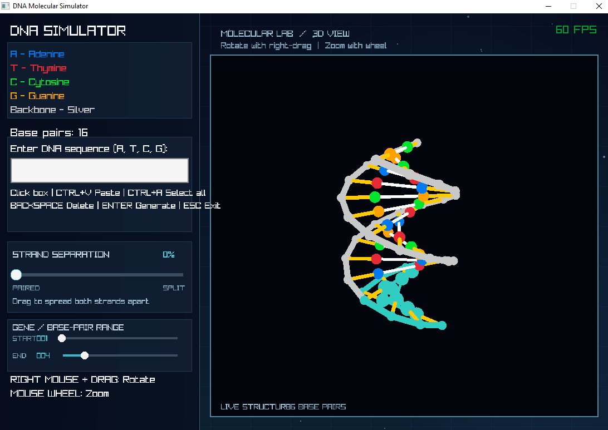

# 3D DNA Simulator

My first C++ graphics project, built using raylib.

## Screenshot

## Features
- 3D DNA double helix
- A-T and C-G complementary pairing
- Interactive camera
- DNA sequence input
- Clipboard paste support

## Technologies
- C++
- raylib 6.2